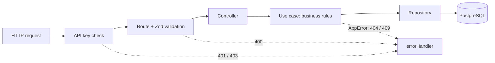

<!-- @template:only:start -->
# template-nodejs-express-lambda-prisma-api

[](https://github.com/HenriqueVon/template-nodejs-express-lambda-prisma-api/actions/workflows/deploy.yml)
[](https://github.com/HenriqueVon/template-nodejs-express-lambda-prisma-api/actions/workflows/codeql.yml)
[](LICENSE)

A production-minded starting point for REST APIs on **AWS Lambda**: Node.js 24, TypeScript, Express, Zod, tsyringe and Prisma 7 on PostgreSQL. Create a project, run one command, and start with a layered architecture, a tested OpenAPI document, CI/CD and written conventions already in place.

[**Use this template**](https://github.com/HenriqueVon/template-nodejs-express-lambda-prisma-api/generate) · [**Browse the API docs**](https://henriquevon.github.io/template-nodejs-express-lambda-prisma-api/) (static Swagger UI of the example module)

## Why it is useful

- **A clear flow in every module.** route → Zod validation → controller → use case → repository → Prisma. Each layer has one job and the rules are written down in [docs/CONVENTIONS.md](docs/CONVENTIONS.md).
- **Documentation that cannot drift.** The OpenAPI document is checked by tests against the Express routes, the Prisma model, the error bodies and the real request pipeline. A change to a route without its docs fails the build.
- **Tested against a real database.** Besides the fast unit tests, an integration suite runs the repositories and the whole API on PostgreSQL (locally with Docker Compose, in CI with a service container) and checks that the migrations produce exactly the `schema.prisma`.
- **Built for Lambda, not just deployed to it.** A small, configurable database pool per container, a throttle on the API, structured JSON logs and a request id that matches the API Gateway one. The trade-offs are written down in [docs/SERVERLESS.md](docs/SERVERLESS.md).
- **Decisions, not just code.** Six [architecture decision records](docs/adr/README.md) say why Express, why use cases and repositories, why Prisma, why one Lambda, and what each choice costs.
- **One command to start.** `npm run init -- --name orders-api` renames the service everywhere, creates the `.env` with a random API key and can remove the example module.
- **A reference module.** `src/modules/example` is a complete CRUD with use case, route and contract tests, to copy when adding a resource.
- **Deploy pipeline included.** GitHub Actions run lint, type check and tests, apply the Prisma migrations and deploy to AWS with the Serverless Framework, per environment, through an OIDC role.
- **Ready for AI-assisted work.** `CLAUDE.md` and `docs/` give an assistant, or a new teammate, the architecture, the conventions and the checks to run.

## Use it

1. Click **Use this template** (or copy this folder).
2. Run `npm run init -- --name orders-api` (add `--remove-example` to start without the example module).
3. Run `docker compose up -d` (a local PostgreSQL), then `npm install`, `npm run prisma:generate`, `npm run prisma:migrate:dev` and `npm run dev`.

Every option, the decisions behind the template and how to evolve it are in [TEMPLATE.md](TEMPLATE.md).

## The first minutes, with real output

What creating a project named `orders-api` looks like. The output below was copied from a real run, with the cuts marked; your timings will differ, and `npm install` is left out because it only downloads packages.

<details>
<summary>Create the project, start the database, migrate and run the tests</summary>

**1. Create the project from the template**

```text
$ npm run init -- --name orders-api

Project "orders-api" (Orders API) is ready.
The example module was kept: delete it when you no longer need it as a reference.
.env was created from .env.example with a generated API_KEY. Its database URLs match docker-compose.yml.

Next steps:
  1. npm install
  2. docker compose up -d         (local PostgreSQL; or point DATABASE_URL and SHADOW_DATABASE_URL in .env to yours)
  3. npm run prisma:generate
  4. npm run prisma:migrate:dev   (applies the migrations to your local database)
  5. npm run dev                  (http://localhost:3000/health, docs at /docs)
  6. npm run lint && npm run check:ts && npm run test:run

Before the first deploy: set the AWS_ROLE_ARN and AWS_REGION variables, and the DATABASE_URL,
DIRECT_DATABASE_URL and API_KEY secrets, in the dev and prd GitHub environments.
```

**2. Start a local PostgreSQL** (it creates the application, shadow and test databases)

```text
$ docker compose up -d
 Network orders-api_default  Creating
 Network orders-api_default  Created
 Volume "orders-api_db-data"  Creating
 Volume "orders-api_db-data"  Created
 Container orders-api-db  Creating
 Container orders-api-db  Created
 Container orders-api-db  Starting
 Container orders-api-db  Started
```

**3. Apply the migrations** (the lines about the Prisma configuration and its update notice are cut)

```text
$ npm run prisma:migrate:dev

Applying migration `20260101000000_create_table_examples`

The following migration(s) have been applied:

migrations/
  └─ 20260101000000_create_table_examples/
    └─ migration.sql

Your database is now in sync with your schema.
```

**4. Run the unit tests** (no database needed; the list of files is cut)

```text
$ npm run test:run

 Test Files  17 passed (17)
      Tests  107 passed (107)
   Duration  3.11s (transform 2.29s, setup 8.28s, import 11.67s, tests 1.19s, environment 4ms)
```

**5. Run the integration tests** (against the database of step 2; the list of files is cut)

```text
$ npm run test:integration

 Test Files  2 passed (2)
      Tests  26 passed (26)
   Duration  15.70s (transform 295ms, setup 241ms, import 810ms, tests 860ms, environment 0ms)
```

Most of the 15 seconds go to applying the migrations and checking that they produce exactly `schema.prisma`. Then `npm run dev` starts the API, and the next section shows a request.

</details>

## How a request flows



`GET /health` is the only public route. A controller never holds business logic, a use case never touches Prisma, and only the repository talks to the database.

## Try it

With the server running (`npm run dev`) and the `API_KEY` of your `.env`:

```bash
curl -X POST http://localhost:3000/v1/api/examples \
  -H "x-api-key: $API_KEY" -H "content-type: application/json" \
  -d '{"name": "First example", "description": "A record used to show the pattern of a module"}'
```

```json
{
  "id": "cm1234567890abcdefghijkl",
  "name": "First example",
  "description": "A record used to show the pattern of a module",
  "createdAt": "2026-01-01T00:00:00.000Z",
  "updatedAt": "2026-01-01T00:00:00.000Z"
}
```

The same request without `x-api-key` answers `401 {"message":"Missing x-api-key header","code":"UNAUTHORIZED"}`, and a name shorter than 3 characters answers `400` with the list of invalid fields. Every response above is part of the OpenAPI document, which the tests compare with the real behavior.

Every response carries an `x-request-id` header, and the server writes one JSON line per request with the same id. These are the lines of a failed and a successful call, as the server printed them:

```json
{"time":"2026-11-23T12:13:59.213Z","level":"info","event":"http_request","requestId":"60533a06-c764-411f-8415-3280c1d2bf54","method":"POST","path":"/v1/api/examples","status":201,"durationMs":156.1}
{"time":"2026-11-23T12:13:59.217Z","level":"warn","event":"app_error","requestId":"d66932b9-8a0c-47a8-b48f-2fd30f6e24c9","status":409,"code":"CONFLICT","message":"Example name already exists!","method":"POST","path":"/v1/api/examples"}
```

## Design notes

| Read | To learn |
|---|---|
| [docs/adr/](docs/adr/README.md) | Why each foundation was chosen, the alternatives, and what it costs |
| [docs/SERVERLESS.md](docs/SERVERLESS.md) | Cold starts, database connections, concurrency, limits, and when not to use Lambda |
| [docs/SECURITY.md](docs/SECURITY.md) | What the API key gives, what it does not, and what to add before real data |
| [docs/ARCHITECTURE.md](docs/ARCHITECTURE.md) | The request lifecycle, the layers and the test strategy |

## What is inside

```
src/
├── app.ts  handler.ts  local.ts  routes.ts     Express app, Lambda handler, local server
├── config/                                      typed environment variables
├── shared/                                      errors, middlewares, DI container, shared schemas
├── services/database/prisma/                    schema and migrations
├── docs/openapi/                                OpenAPI registry, document and its tests
└── modules/example/                             reference CRUD: routes, use cases, repository, tests
```

| Concern | Choice |
|---|---|
| Runtime | Node.js 24, AWS Lambda behind an HTTP API, bundled with esbuild |
| Web | Express 4 through `serverless-http` |
| Validation and docs | Zod 4 and `zod-to-openapi`, Swagger UI on the local server |
| Dependency injection | tsyringe |
| Data | Prisma 7 with the `pg` adapter, PostgreSQL |
| Tests | Vitest and Supertest |
| CI/CD | GitHub Actions and the Serverless Framework |

---

*Below is the README every new project starts with; `npm run init` replaces everything above this line.*

<!-- @template:only:end -->
# My Service API

> One sentence about what this service does. Replace this line.

REST API running on AWS Lambda. The business concepts are described in [docs/DOMAIN.md](docs/DOMAIN.md).

**Stack:** TypeScript · Express 4 · Zod · tsyringe · Prisma 7 (PostgreSQL) · Vitest · AWS Lambda (Serverless Framework).

## Quick Start

Requirements: Node.js 24 (see `.nvmrc`), npm, and Docker (or any PostgreSQL database you control).

```bash
npm install
```

Create `.env` from [`.env.example`](.env.example) (set `API_KEY`; the database URLs already match the Docker database). Then start the database:

```bash
docker compose up -d
```

```bash
npm run prisma:generate
```

```bash
npm run prisma:migrate:dev
```

```bash
npm run dev
```

The API listens on `http://localhost:<PORT>/v1/api`. `GET /health` is public; every other request needs the header `x-api-key: <API_KEY>`.

Set `DOCS_ENABLED=true` to serve Swagger UI at `http://localhost:<PORT>/docs`. Docs are served by the local server only.

Full setup, commands, migrations and workflow: [docs/DEVELOPMENT.md](docs/DEVELOPMENT.md).

## Checks

```bash
npm run lint
```

```bash
npm run check:ts
```

```bash
npm run test:run
```

The integration tests need the Docker database (`docker compose up -d`) and `TEST_DATABASE_URL` from `.env.example`:

```bash
npm run test:integration
```

CI runs the same checks, plus the integration tests against a PostgreSQL service container, on pull requests to `develop`/`main` and before every deploy.

## Deployment

A push to `develop` deploys the `dev` stage; a push to `main` deploys `prod` (GitHub Actions + Serverless). Pending database migrations are applied by the pipeline to the target stage before the deploy. The required GitHub environments, variables and secrets are listed in [docs/DEVELOPMENT.md §11](docs/DEVELOPMENT.md#11-deployment).

## Documentation

| Document | Purpose |
|---|---|
| [CLAUDE.md](CLAUDE.md) | How an AI assistant operates in this repository. |
| [docs/ARCHITECTURE.md](docs/ARCHITECTURE.md) | How the system is built today. |
| [docs/DEVELOPMENT.md](docs/DEVELOPMENT.md) | Setup, commands, step-by-step guides and pitfalls. |
| [docs/CONVENTIONS.md](docs/CONVENTIONS.md) | The rules new code follows. |
| [docs/SERVERLESS.md](docs/SERVERLESS.md) | Running on Lambda: trade-offs and the checklist before production. |
| [docs/SECURITY.md](docs/SECURITY.md) | What is protected, the limits of the API key and what to add. |
| [docs/adr/](docs/adr/README.md) | Architecture decision records. |
| [docs/DOMAIN.md](docs/DOMAIN.md) | Business concepts and rules. |

## License

[MIT](LICENSE)
